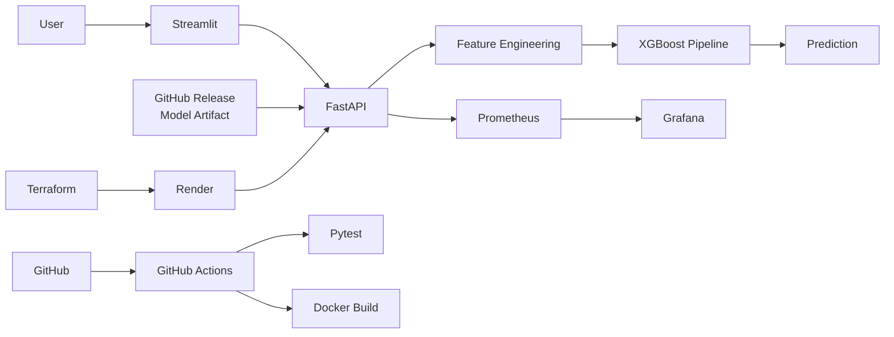

# House Price ML System

An end-to-end machine learning system for house price prediction, built on the Kaggle **House Prices: Advanced Regression Techniques** dataset.

The project covers the full ML engineering lifecycle: feature engineering, model serving, artifact versioning, testing, containerization, observability, infrastructure as code, CI, and cloud deployment.

## Live Demo

- **Web App:** https://house-price-ml-system.streamlit.app/
- **API:** https://house-price-api-20dk.onrender.com
- **API Docs:** https://house-price-api-20dk.onrender.com/docs

> The backend runs on Render's free tier and may require a short cold start after inactivity.


## Architecture



Production request flow:

```text
User
  ↓
Streamlit Community Cloud
  ↓
FastAPI on Render
  ↓
Feature Engineering
  ↓
ML Pipeline
  ↓
Predicted Price
```

The trained model is not stored in Git or baked into the Docker image. At startup, the API downloads the versioned artifact from GitHub Releases and loads it once into memory.


## Model

**Kaggle Public RMSLE:** `0.12813`

The pipeline includes:

- missing-value handling
- categorical encoding
- numerical preprocessing
- feature engineering
- XGBoost regression
- logarithmic target transformation

The model is trained with:

```python
np.log1p(SalePrice)
```

Predictions are converted back with:

```python
np.expm1(prediction)
```

Engineered features include:

```text
HasGarage
TotalSF
HouseAge
RemodAge
GarageAge
TotalBathrooms
```

The same feature engineering logic is reused during training and inference.


## Model Artifact Versioning

Current artifact:

```text
model-v1
house_price_pipeline.joblib
```

The artifact is distributed through **GitHub Releases**.

```text
API startup
    ↓
Check local model
    ↓
Download artifact if missing
    ↓
Load with joblib
    ↓
Serve requests
```

The model was serialized with `scikit-learn==1.6.1`, and production pins the same version to avoid serialization compatibility issues.


## API

The backend uses **FastAPI**, **Uvicorn**, and **Pydantic**.

```text
GET  /health
POST /predict
GET  /metrics
GET  /docs
```

Example response:

```json
{
  "predicted_price": 338819.1875
}
```

The model is loaded once during FastAPI lifespan startup and stored in application state instead of being reloaded for every request.


## Web Interface

The frontend is built with **Streamlit**.

Users can:

- select example houses
- modify important house features
- generate random variations
- send predictions to the deployed API
- view the predicted sale price

The frontend communicates with the FastAPI service over HTTP.


## Observability

The API exposes Prometheus-compatible metrics through `/metrics`.

Tracked metrics include:

- HTTP request count
- request latency
- prediction values
- selected feature distributions

A local Docker Compose monitoring stack runs:

```text
FastAPI
Streamlit
Prometheus
Grafana
```

Grafana dashboards visualize metrics such as:

- total predictions
- average predicted price
- P95 latency
- server errors

Structured logs also include request IDs, method, path, status code, latency, and prediction events.

The Prometheus/Grafana stack currently runs locally rather than in the public free-tier deployment.


## Run Locally

The complete stack can be started with:

```bash
docker compose up --build
```

| Service | URL |
|||
| Streamlit | http://localhost:8501 |
| FastAPI | http://localhost:8000 |
| API Docs | http://localhost:8000/docs |
| Prometheus | http://localhost:9090 |
| Grafana | http://localhost:3000 |

The API and Streamlit frontend use separate Docker images.


## Testing & CI

Tests are implemented with **pytest** and currently cover:

- health endpoint
- prediction integration
- feature engineering

Run locally:

```bash
python -m pytest
```

GitHub Actions runs on `push` and `pull_request`.

```text
Checkout
   ↓
Python 3.13
   ↓
Install dependencies
   ↓
Pytest
   ↓
Docker build
```

This verifies both application behavior and production image buildability.


## Infrastructure & Deployment

The backend infrastructure is managed with **Terraform**.

Terraform defines the Render web service, region, Docker source, deployment branch, health check, and automatic deployments.

```bash
terraform init
terraform validate
terraform plan
terraform apply
```

The existing Render service was imported into Terraform state so infrastructure configuration and remote state remain synchronized.

Deployment architecture:

```text
GitHub
  ↓
Render Docker deployment
  ↓
FastAPI backend
  ↓
GitHub Release model artifact
```

The frontend is deployed separately with **Streamlit Community Cloud**.


## Project Structure

```text
house-price-ml-system/
│
├── api/
│   ├── main.py
│   ├── logging.py
│   └── metrics.py
│
├── src/
│   ├── features.py
│   └── predict.py
│
├── ui/
│   ├── app.py
│   └── requirements.txt
│
├── tests/
│   ├── fixtures/
│   ├── test_api.py
│   └── test_features.py
│
├── monitoring/
│   └── prometheus.yml
│
├── terraform/
│   └── main.tf
│
├── .github/workflows/
│   └── ci.yml
│
├── Dockerfile
├── Dockerfile.ui
├── docker-compose.yml
├── requirements.txt
├── requirements-dev.txt
├── requirements-ui.txt
└── README.md
```


## Tech Stack

**ML:** Python, Pandas, NumPy, scikit-learn, XGBoost, joblib
**Backend:** FastAPI, Uvicorn, Pydantic
**Frontend:** Streamlit
**Testing & CI:** pytest, GitHub Actions
**Containers:** Docker, Docker Compose
**Observability:** Prometheus, Grafana, structured logging
**Infrastructure:** Terraform, Render, GitHub Releases, Streamlit Community Cloud


## Engineering Decisions

**Versioned model artifact**
The trained binary is stored in GitHub Releases instead of Git or the Docker image.

**Pinned inference environment**
The production scikit-learn version matches the version used to serialize the model.

**Single model load**
FastAPI loads the model during application startup rather than per request.

**Separate frontend and backend**
Streamlit consumes the prediction API instead of importing the model directly.

**Infrastructure as Code**
Render infrastructure is defined with Terraform.

**Automated verification**
GitHub Actions runs tests and validates that the production Docker image still builds.


## Limitations

The backend uses Render's free tier, so the first request after inactivity may experience cold-start latency.

Prometheus and Grafana are currently part of the local deployment only.


## Summary

This project demonstrates the complete path from a trained model to a deployed ML system:

```text
Training
  ↓
Evaluation
  ↓
Artifact Versioning
  ↓
API Serving
  ↓
Testing
  ↓
Docker
  ↓
Observability
  ↓
Terraform
  ↓
 CI
  ↓
Cloud Deployment
  ↓
Public Web App
```
